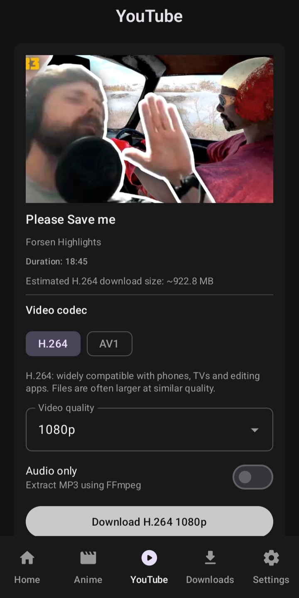

# PiraChest for Android

An Android adaptation of PiraChest, focused on **Anime and YouTube**.

> [!WARNING]
> **AI-assisted development:** Free AI models and tools were used during development to help debug, refactor, and improve parts of the code. Their suggestions were reviewed and tested, but they can still be wrong. This is an early release, so please report bugs with clear reproduction steps.

This project is based on [TheJustRun/PiraChest](https://github.com/TheJustRun/PiraChest). It is a separate Android adaptation, not the original desktop application or an official release from the upstream maintainer.

---

## Features

### Anime
- Anime discovery and catalogue information from AniList.
- Episode browsing and provider selection.
- Built-in video playback.
- Fullscreen playback and screen rotation.
- Episode downloads when a compatible source is available.

### YouTube
- YouTube video link fetching.
- Video and audio downloads.
- Available format and quality selection.
- Video information and thumbnail previews.
- yt-dlp integration for media extraction.

### Other features
- Download queue with progress information.
- Download history.
- Local media playback.
- FFmpeg integration for media processing.
- App appearance and playback settings.
- Dark theme support.

---

## Screenshots

<p align="center">
  
  
</p>

<p align="center">
  
</p>

---

## Supported content

PiraChest for Android currently focuses on two supported areas:

- **Anime** — browse catalogue information, view episodes, choose available providers, watch streams, and download episodes when a compatible source is available.
- **YouTube** — inspect supported YouTube links and download available video or audio formats.

Other sections shown as "Coming soon" are not currently supported download features.

Provider and stream availability depends on third-party websites and can change without notice.

---

## Content and hosting disclaimer

<table>
<tr>
<td>

### 

**PiraChest does not host any files or media content.**

The application does not upload, store, or maintain its own collection of videos, anime episodes, or other downloadable media.

It works with information and media sources provided by third-party services and websites. Availability and access depend on those external sources.

Users are responsible for ensuring that their use of the application complies with applicable copyright laws, website terms, and local regulations.

</td>
</tr>
</table>

---

## How downloads work

- **yt-dlp** handles supported YouTube link extraction and media downloads.
- **FFmpeg** is bundled for supported media processing and format handling.
- Anime streams and episode downloads depend on the providers available in the app.

### Technologies used

- Kotlin
- Jetpack Compose
- Material 3
- AndroidX Media3
- yt-dlp
- FFmpeg
- OkHttp
- Jsoup
- AniList API

---

## Download

Get the latest Android APK from the [GitHub Releases page](https://github.com/PorkSandwitch/PiraChest-Android/releases).

**Current release:** [PiraChest v0.1.0](https://github.com/PorkSandwitch/PiraChest-Android/releases/tag/v0.1.0)

Install the APK manually on your Android device. Android may ask you to allow installations from your browser or file manager.

---

## Build from source

### Requirements

- Android Studio
- JDK 17
- Android SDK Platform 36
- Gradle 8.11.1
- Android device or emulator (API 26 or newer)

### Build instructions

1. Clone the repository:

   ```bash
   git clone https://github.com/PorkSandwitch/PiraChest-Android.git
   ```

2. Open the project in Android Studio.
3. Set the Gradle JDK to Java 17.
4. Install Android SDK Platform 36 if prompted.
5. Sync the project with Gradle.
6. Build and run the `app` configuration, or use **Build > Build Bundle(s) / APK(s)**.

The project does not include `local.properties`; Android Studio creates this file for your local SDK installation. Do not commit your own `local.properties` file.

### Release builds

A release APK must be signed with a private release keystore.

- Keep your keystore and passwords somewhere safe.
- Never commit your keystore to GitHub.
- Never share your signing credentials.
- Keep a secure backup of your keystore.

The same signing key is required for future app updates.

---

## Project status

**Version:** `0.1.0`

This is the first public Android release. Some features may be incomplete, and changes to third-party providers or websites may affect stream discovery and downloads.

If you find a bug, please [open an issue](https://github.com/PorkSandwitch/PiraChest-Android/issues).

When reporting an issue, include:

- Your device model.
- Android version.
- Steps to reproduce the problem.
- Relevant error messages or logs.

Avoid posting passwords, account tokens, or other private information.

---

## Credits

- [TheJustRun/PiraChest](https://github.com/TheJustRun/PiraChest) — original project this Android adaptation is based on.
- [yt-dlp](https://github.com/yt-dlp/yt-dlp) — YouTube media extraction.
- [FFmpeg](https://ffmpeg.org/) — media processing.
- [AniList](https://anilist.co/) — anime catalogue data.
- The developers and maintainers of the libraries used in this project.

This repository is maintained separately from the original desktop project. Please report Android-specific issues here. Issues related to the original desktop application should be reported to the [upstream repository](https://github.com/TheJustRun/PiraChest).

---

## License

This Android adaptation is based on the upstream PiraChest project, which identifies its license as the **PolyForm Noncommercial License 1.0.0**.

This project uses the same license for portions derived from or covered by the upstream project. The license is noncommercial. Review the [PolyForm Noncommercial License 1.0.0](https://polyformproject.org/licenses/noncommercial/1.0.0/) before using, modifying, or redistributing this project.

Third-party libraries and components may have their own licenses. Those remain subject to their respective license terms.
