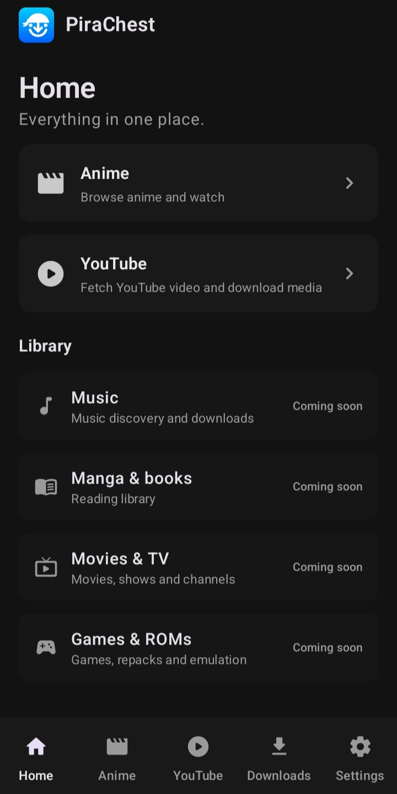
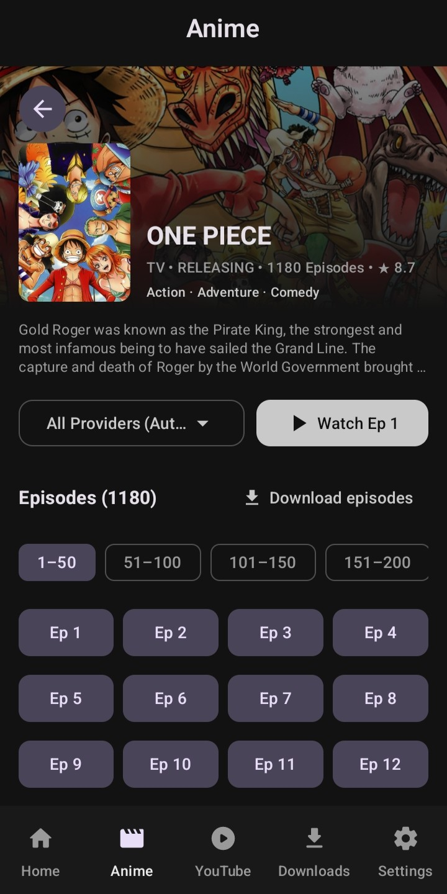
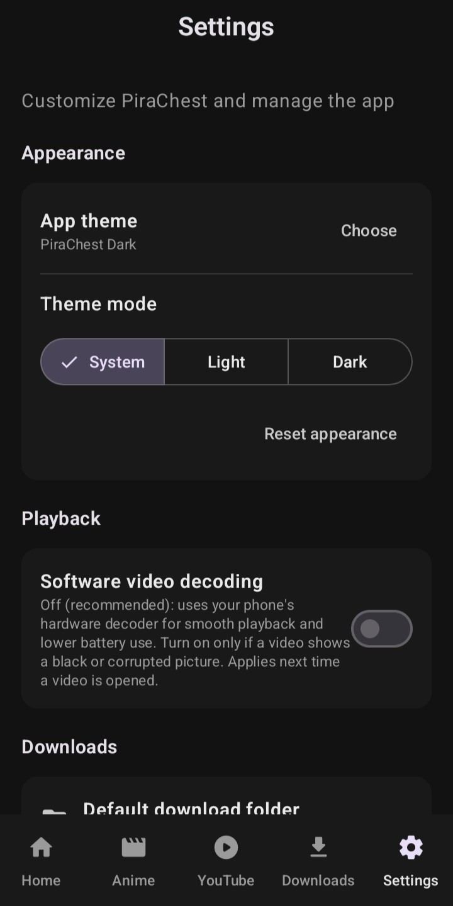

# PiraChest for Android

An Android adaptation of PiraChest, focused on **anime** and **YouTube**.

> [!WARNING]
> **AI-assisted development:** Free AI models and tools were used during development to help debug, refactor, and improve parts of the code. Their suggestions were reviewed and tested, but they can still be wrong. This is an early release, so please report bugs with clear reproduction steps.

This project is based on [TheJustRun/PiraChest](https://github.com/TheJustRun/PiraChest). It is a separate Android adaptation, not the original desktop application or an official release from the upstream maintainer.

---

## Screenshots

| Home | Anime |
|:---:|:---:|
|  |  |

| YouTube | Settings |
|:---:|:---:|
|  |  |

---

## What it does

PiraChest for Android currently supports two areas:

- **Anime** — browse catalogue information, view episodes, choose available providers, watch streams, and download episodes when a compatible source is available.
- **YouTube** — inspect supported YouTube links and download available video or audio formats.

Other sections shown as “Coming soon” are not currently supported download features. This Android version is focused on anime and YouTube only.

### Main features

- Anime discovery and catalogue information from AniList
- Episode lists and provider selection
- Built-in video playback with fullscreen and rotation support
- YouTube link fetching and format/quality selection
- Download queue, progress, and download history
- Local playback of downloaded media
- FFmpeg-powered media processing
- App appearance and playback settings

Provider and stream availability depends on third-party websites and can change without notice.

## How downloads work

- **yt-dlp** is used to inspect supported YouTube links and handle YouTube media downloads.
- **FFmpeg** is bundled for supported media processing and format handling.
- Anime streams and episode downloads depend on the providers available in the app.

PiraChest does not host, upload, or store a catalogue of videos on its own servers. It works with information and media sources provided by third-party services and websites.

Use the app responsibly. Respect copyright, the terms of the websites you access, and the laws that apply where you live. You are responsible for your use of the app and any content you access or download.

## Download

Get the latest Android APK from the [GitHub Releases page](https://github.com/PorkSandwitch/PiraChest-Android/releases).

For the first public release, see [PiraChest v0.1.0](https://github.com/PorkSandwitch/PiraChest-Android/releases/tag/v0.1.0).

Install the APK manually on your Android device. Android may ask you to allow installs from the browser or file manager you use.

## Build from source

### Requirements

- Android Studio
- JDK 17
- Android SDK Platform 36
- Gradle 8.11.1
- An Android device or emulator (API 26 or newer)

### Build

1. Clone the repository:

   ```bash
   git clone https://github.com/PorkSandwitch/PiraChest-Android.git
   cd PiraChest-Android
   ```

2. Open the project in Android Studio.
3. Set the Gradle JDK to Java 17.
4. Install Android SDK Platform 36 if prompted, then sync the project.
5. Build and run the `app` configuration, or use **Build > Build Bundle(s) / APK(s)**.

The project does not include `local.properties`; Android Studio creates it for your local SDK installation. Do not commit your own `local.properties`.

### Signing a release build

A release APK must be signed with a private release keystore. Keep the keystore and its passwords somewhere safe, outside the repository. Never commit them or attach them to a public release. The same signing key is needed for future app updates.

## Tech stack

- Kotlin
- Jetpack Compose and Material 3
- AndroidX Media3
- [yt-dlp](https://github.com/yt-dlp/yt-dlp), through the `youtubedl-android` library
- [FFmpeg](https://ffmpeg.org/), through the `youtubedl-android` FFmpeg package
- OkHttp and Jsoup
- [AniList](https://anilist.co/) catalogue data

## Project status

**Current version: `0.1.0`**

This is an early release. Some features may be incomplete, and changes to third-party providers or websites may affect stream discovery and downloads. If something breaks, please [open an issue](https://github.com/PorkSandwitch/PiraChest-Android/issues) and include your device model, Android version, steps to reproduce the problem, and relevant logs. Do not include passwords, account tokens, or other private information.

## Credits

- [TheJustRun/PiraChest](https://github.com/TheJustRun/PiraChest) — upstream project this Android adaptation is based on
- [yt-dlp](https://github.com/yt-dlp/yt-dlp) — YouTube media extraction
- [FFmpeg](https://ffmpeg.org/) — media processing
- [AniList](https://anilist.co/) — anime catalogue data
- The maintainers of the libraries used by this project

This repository is maintained separately from the original desktop project. Please report Android-specific issues here.

## License

This Android adaptation is based on the upstream PiraChest project, which identifies its license as the **PolyForm Noncommercial License 1.0.0**. This project uses the same license for portions derived from or covered by the upstream project. The license is noncommercial; review the [license terms](https://polyformproject.org/licenses/noncommercial/1.0.0/) before using, modifying, or redistributing the project.

Third-party libraries and components may have their own licenses. Those remain subject to their respective terms.
